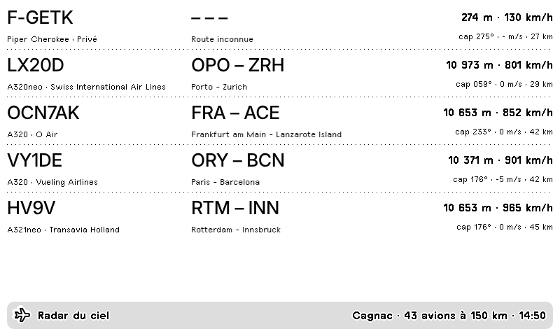
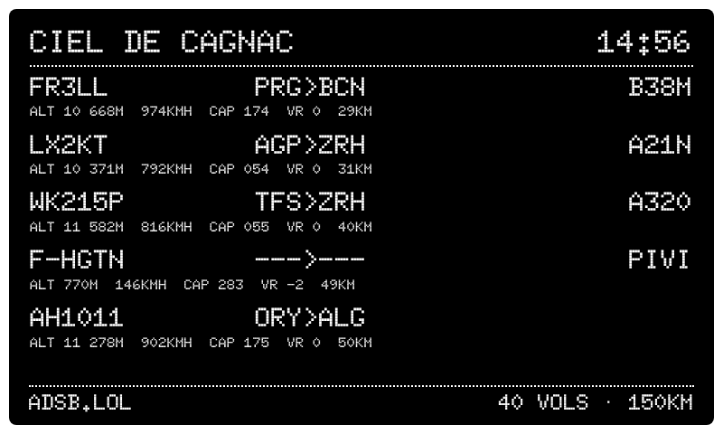
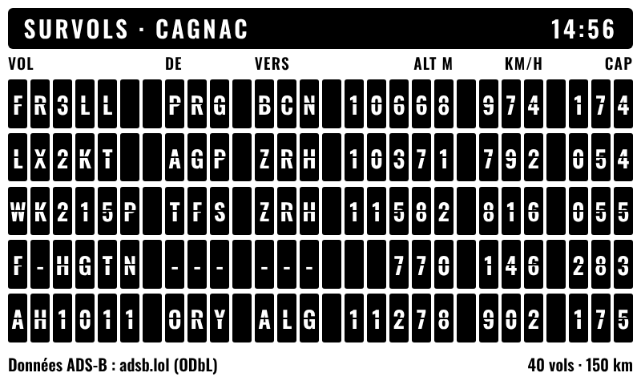
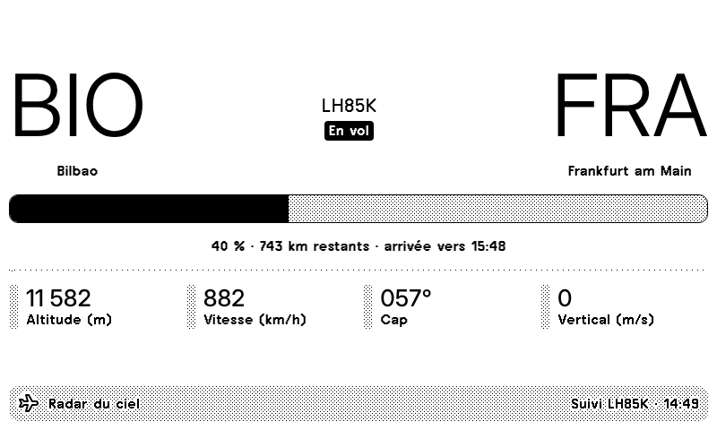
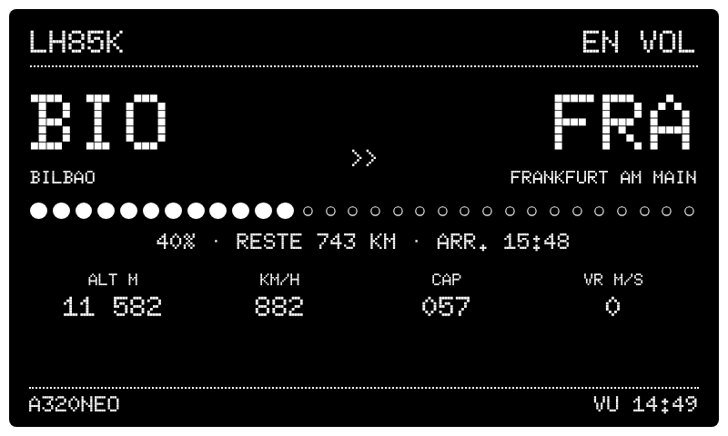
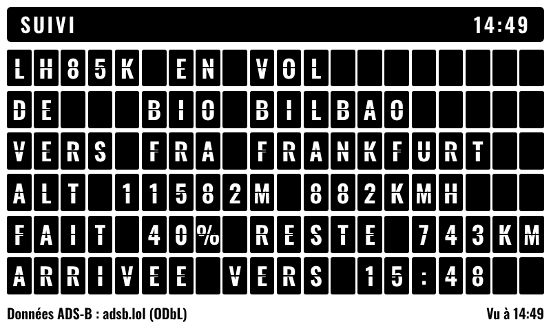
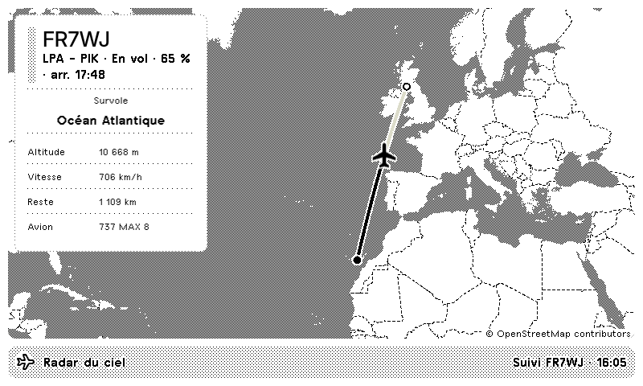
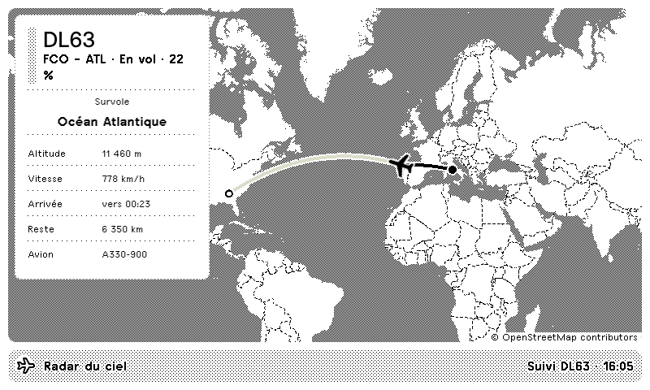
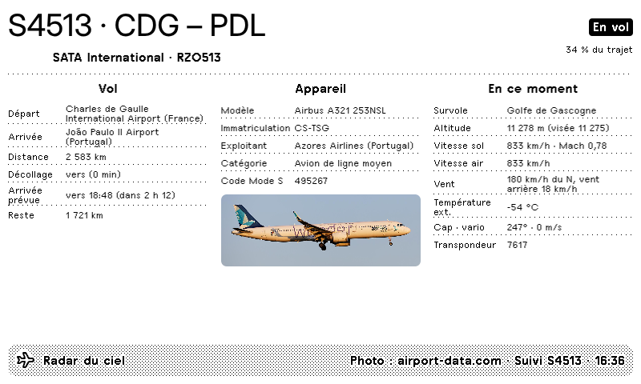
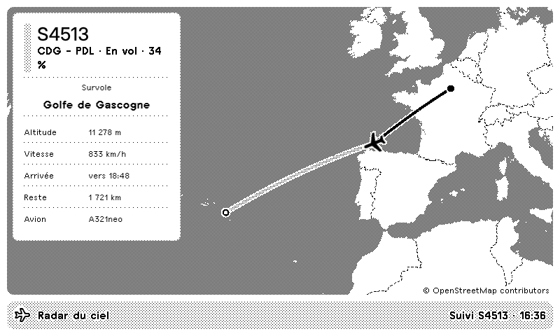

# Radar du ciel — plugin TRMNL

Affiche sur un TRMNL les avions qui survolent Cagnac-les-Mines (rayon de 30 km), avec leur route, leur type et leurs mesures, ou suit un vol précis de bout en bout.

- **Deux modes** : *zone* (les 5 avions les plus proches) et *suivi* (un vol choisi, avec progression, distance restante et heure d'arrivée estimée).
- **Trois styles**, au choix dans les réglages du plugin : Classique, LED et Flip-flap.
- **Carte du suivi** (option) : la position de l'avion, sa trajectoire parcourue et le trajet restant, sur les cartes TRMNL (MapLibre + tuiles OpenStreetMap).
- **Ce que survole l'avion** en mode suivi : ville proche, pays, mer ou océan.
- **Fiche détaillée** (option) : aéroports complets, distance, décollage estimé, arrivée prévue ; modèle exact, immatriculation, exploitant, photo ; vitesse air, Mach, vent (de face ou arrière), température extérieure, transpondeur.
- **Quatre styles de carte** : Contours, Rues, Minimal, Épuré.
- **Unités** : mètres, km/h, m/s.
- **Données** : position ADS-B via [adsb.lol](https://adsb.lol) (ODbL), routes et compagnies via [adsbdb.com](https://www.adsbdb.com). Tout est gratuit et sans clé.

| | Classique | LED | Flip-flap |
|---|---|---|---|
| Zone |  |  |  |
| Suivi |  |  |  |

| Carte du suivi | Long-courrier |
|---|---|
|  |  |
| **Fiche détaillée** | **Carte « Minimal »** |
|  |  |

## Comment ça marche

1. Toutes les 5 minutes, cron-job.org lance le workflow **Actualiser le radar**. Le planificateur de GitHub prend le relais toutes les 15 minutes si cron-job.org ne répond pas.
2. Le workflow interroge adsb.lol et adsbdb, puis publie `flights.json` sur la branche `data`.
3. Le TRMNL lit ce fichier à l'adresse `https://raw.githubusercontent.com/nbbou81000/trmnl-radar-ciel/data/flights.json`.

La branche `data` est réécrite à chaque passage (un seul commit), donc l'historique du dépôt ne grossit pas.

## Installation (tout à la souris)

### 1. Créer le dépôt
1. Sur github.com, crée un dépôt **public** nommé `trmnl-radar-ciel`.
2. Envoie-y tout le contenu de ce dossier, y compris le dossier `.github`. Le plus simple est de passer par GitHub Desktop : *Add an existing repository*, puis *Publish*.

### 2. Premier lancement
1. Onglet **Actions** du dépôt, puis **Actualiser le radar** et **Run workflow**.
2. Au bout d'une minute environ, la branche `data` apparaît avec `flights.json`.

> Si le workflow échoue à l'étape « Publier », va dans **Settings → Actions → General → Workflow permissions**, coche **Read and write permissions** et relance.

### 3. Actualisation toutes les 5 minutes (cron-job.org)
1. Sur GitHub : **Settings** (de ton compte) → **Developer settings** → **Fine-grained tokens** → **Generate new token**.
   - Repository access : *Only select repositories* → `trmnl-radar-ciel`
   - Permissions : **Actions → Read and write**
   - Copie le jeton.
2. Sur cron-job.org, crée une tâche :
   - URL : `https://api.github.com/repos/nbbou81000/trmnl-radar-ciel/actions/workflows/actualiser.yml/dispatches`
   - Fréquence : toutes les 5 minutes
   - Onglet *Advanced* → Request method : **POST**
   - Headers :
     - `Authorization` : `Bearer TON_JETON`
     - `Accept` : `application/vnd.github+json`
   - Request body : `{"ref":"main"}`
3. Lance un test : cron-job.org doit répondre **204**.

### 4. Le plugin TRMNL
1. Sur trmnl.com : **Plugins → Private Plugin → Add new**.
2. Strategy : **Polling**. Polling URL :
   `https://raw.githubusercontent.com/nbbou81000/trmnl-radar-ciel/data/flights.json`
3. Refresh rate : le plus court proposé (5 minutes). Règle aussi l'intervalle de rafraîchissement de l'appareil sur 5 minutes.
4. **Form fields** : colle le contenu de `trmnl/custom-fields.yml`. Trois réglages apparaissent alors dans le plugin : le style d'affichage, l'écran pendant un suivi (tableau, carte ou fiche détaillée) et le style de la carte.
5. **Edit Markup** : colle chaque fichier dans l'onglet correspondant.
   - `trmnl/shared.liquid` → Shared
   - `trmnl/full.liquid` → Full
   - `trmnl/half_horizontal.liquid` → Half horizontal
   - `trmnl/half_vertical.liquid` → Half vertical
   - `trmnl/quadrant.liquid` → Quadrant
6. Enregistre, puis ajoute le plugin à la playlist de ton TRMNL.

## Suivre un vol

1. Onglet **Actions** → **Suivre un vol** → **Run workflow**.
2. Dans la case **vol**, saisis au choix :
   - le numéro de vol : `AF6125`
   - l'indicatif radio : `AFR6125`
   - l'immatriculation de l'avion : `F-HPNA`
3. La date de fin (format `AAAA-MM-JJ`) est facultative.

L'écran passe aussitôt en mode suivi. Il revient seul au mode zone dans l'un de ces cas :
- 45 minutes après l'atterrissage,
- à la date de fin si tu en as indiqué une,
- au bout de 48 heures sinon.

Pour revenir plus tôt : **Actions → Arrêter le suivi → Run workflow**.

Pendant le suivi, l'écran indique ce que survole l'avion : « Toulouse, France », « Près de Rodez, France », « Golfe de Gascogne », « Océan Atlantique »… Si tu as choisi l'écran **Carte** dans les réglages du plugin, tu vois l'avion orienté selon son cap, le trajet déjà parcouru en noir et le trajet restant en gris.

> L'ADS-B ne voit un avion que lorsque son transpondeur émet, en général peu avant le décollage. Avant, l'écran affiche « Pas encore détecté », avec la route si elle est connue.

## Changer la zone

Modifie `config.json` directement sur GitHub (icône crayon), puis **Commit changes** :

| Clé | Rôle |
|---|---|
| `lieu`, `lieu_court` | Nom affiché (le court sert dans les en-têtes) |
| `latitude`, `longitude` | Centre de la zone |
| `rayon_km` | Rayon de recherche |
| `vols_max` | Nombre d'avions conservés (5 au maximum à l'écran) |
| `inclure_au_sol` | `true` pour garder aussi les avions au sol |

## Données géographiques

« Survole … » est calculé hors ligne, sans aucun service extérieur, à partir des fichiers du dossier `geo/` :
- pays, mers et océans : Natural Earth (domaine public), en français ;
- villes : GeoNames (CC BY 4.0). Le monde est couvert à partir de 5 000 habitants, la France à partir de 1 000.

Pour rafraîchir ces données (rarement utile) : **Actions → Préparer les données géographiques → Run workflow**.

## Limites

- **Pas de temps réel** : l'écran montre le ciel au dernier rafraîchissement, soit 5 minutes au mieux, et non à 10 secondes près comme un panneau LED.
- **Routes indicatives** : adsbdb donne la route habituelle d'un indicatif, qui peut être fausse pour un vol exceptionnel ou affrété. Quand l'avion s'écarte nettement du trajet prévu, l'écran l'indique (« route incertaine »).
- **Fiche détaillée** : affichée en plein écran et en demi-écran vertical ; dans les vues plus petites, c'est le tableau de suivi qui s'affiche. La photo de l'appareil vient d'airport-data.com quand elle existe.
- **Carte** : elle n'existe qu'en mode suivi. Le framework TRMNL attend jusqu'à 6 secondes le chargement des tuiles ; si leur serveur est lent, la carte peut rester incomplète jusqu'au rafraîchissement suivant.
- **Styles LED et flip-flap** : ils utilisent leur propre CSS (`<style>` dans *Shared*) et les polices Google Doto et Oswald. Ça ne gêne pas un plugin privé, mais le linter Chef le signalera si un jour tu en fais une recette publique.

## Fichiers

- `scripts/radar.mjs` : la collecte (zone et suivi) ; `scripts/types.mjs` : noms lisibles des types d'avions ; `scripts/geo.mjs` : « Survole … » ; `scripts/build-geo.mjs` : préparation du dossier `geo/`.
- `.github/workflows/` : *Actualiser le radar*, *Suivre un vol*, *Arrêter le suivi*, *Préparer les données géographiques* et `_radar.yml` (étapes communes, ne pas lancer directement).
- `trmnl/` : gabarits à coller dans TRMNL. Ils sont générés à partir de `trmnl/src/body.liquid` : ne modifie pas les quatre fichiers de taille à la main.
